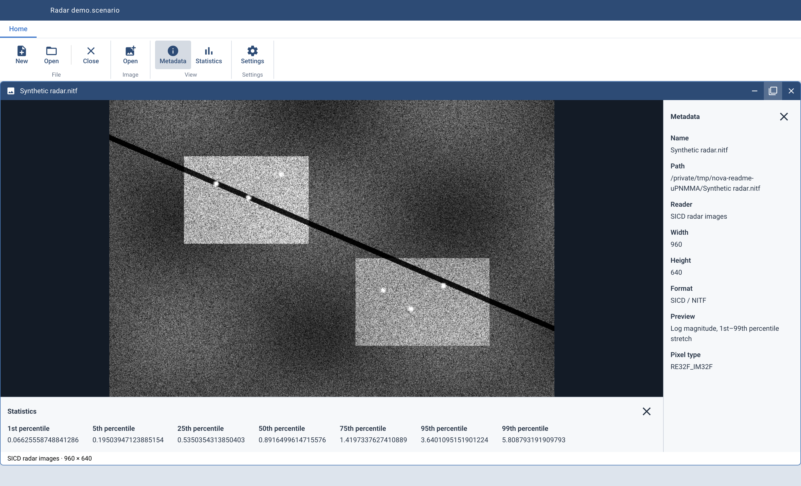

# Nova

[](https://github.com/johnluscombe/nova/actions/workflows/ci.yml)
[](https://github.com/johnluscombe/nova/actions/workflows/ci.yml)

An Electron workspace for radar imagery, built with Vue, Quasar, and SQLite.



_Nova displaying synthetic SICD radar data with the Metadata and Statistics panels open._

## Development

```sh
npm install
npm run dev
```

Use Node.js 24 or newer. Electron dependencies are installed in `src-electron`
by Quasar when running or building the app.

```sh
npm run build       # Package the Electron app
npm run typecheck
npm run lint:check
npm test            # Vitest unit tests
npm run test:e2e    # Build and test Electron with Playwright
npm run test:coverage:all
```

Combined coverage is available at `coverage/combined/index.html`.
See [testing and coverage](docs/testing.md) for setup and reporting details, and
[code documentation and readability](docs/code-style.md) for method documentation
and formatting conventions.

## Scenarios and images

Create or open a `.scenario` SQLite file from the Scenario ribbon group. Image widgets
autosave their file references, positions, sizes, and window states. Nova restores
the last scenario on startup; explicitly closing it clears that preference.
Source images remain separate from the scenario file.

Use **Home → Image → Save** to save the active image. Save opens a destination
dialog every time, letting you choose the filename and output format.
The destination extension selects the output encoding: PNG, JPEG, TIFF, BMP,
or WebP. Scientific images export the first image/channel at source resolution
as an 8-bit display raster using the selected scaling and preview contrast
mapping. SVGs rasterize at their intrinsic dimensions. Scientific raster export,
and BMP/TIFF/WebP conversions, require the Scientific Imagery plugin's configured
Python environment. Exported rasters do not retain complex/calibrated sample
values or scientific metadata; keep the native source for further analysis.

Saving in the original format preserves the file's data and embedded metadata.
Axes, polygons, and attached JSON sidecars are not baked into exported images.
SIDD/SICD files already stored in NITF 2.1 can also be saved with a `.nitf` or
`.ntf` extension; Nova checks the container header before copying. This does not
convert non-NITF sources into NITF.
Graphs and intermediate diagnostic previews cannot be saved with these controls.

Drag a `.scenario` file into Nova to open it, or drop images into an open scenario
to create image widgets. Multiple images can be dropped together. When dropping
a scenario and images together, Nova opens the scenario first.

Bundled plugins support JPG/PNG, SVG, TIFF (`.tif`/`.tiff`), and SICD/SIDD-in-NITF radar imagery.
See [image plugins](docs/image-plugins.md) and [Scientific Imagery setup](docs/scientific-imagery-plugin.md).
The Settings dialog configures the percentiles displayed in Statistics.

Application and test sources use TypeScript. Plugins use Electron's native type
stripping and must use erasable TypeScript syntax. Scenario schema definitions
live in `src-electron/scenario-schema.ts`.

Enable Slice in the contextual image tab’s Analysis group to reveal selection strips on the left and
bottom of the image. Hover over the left strip to preview a horizontal slice, or
the bottom strip for a vertical slice; click to open its graph. SICD plots the selected source quantity; SIDD plots derived intensity or RGB luminance. Other formats plot preview luminance.
Graphs open as independent temporary widgets and are not saved to scenarios.

Use **Scientific Imagery → Edit → Scaling** on SICD images or their slice graphs to select amplitude,
complex components, phase, power, or calibrated radar quantities when available.
Image scaling is saved with the scenario. See [SICD scaling](docs/scientific-imagery-plugin.md#scaling).

Enable **View → Pixel Values** to see pixel coordinates and values while hovering
over an image. SICD reads exact source values in the selected scaling mode;
SIDD and TIFF read source intensity or RGB luminance. Other formats report preview luminance.

Enable **View → Axes** to display image coordinates. SICD range grids show
cross-range and down-range in meters relative to the scene center; ordinary
images use pixel coordinates.

Add Image supports multi-file selection and ZIP imports. JSON metadata can be
associated during import or added later using the image tab’s **Data → Attach Metadata**.
Recognized JSON axes can supply physical coordinates or explicitly override
embedded axes. See [metadata and axis sources](docs/metadata.md).

The contextual tab is named **Scientific Imagery** for SICD, SIDD, CPHD, and TIFF,
or **Image** for ordinary images. It contains **View** (Metadata, Axes, Pixel Values,
Statistics), **Edit** (Scaling, Crop), **Data** (Attach Metadata, with scientific
product creation where supported), and **Analysis** (Polygon, Clear Region, Slice).
Image tools remain available for slice graphs where applicable, and the ribbon
returns to Home when no widget is active.

Use **Analysis → Polygon** to select an image region. Closing it updates Statistics
with regional percentiles; **Clear Region** restores whole-image statistics.
Selections follow scaling changes and are saved in scenarios. See
[polygon regions](docs/regions.md).

PNG/JPG/SVG images provide whole-image preview-luminance percentiles automatically,
so Statistics is available immediately without a polygon selection.
